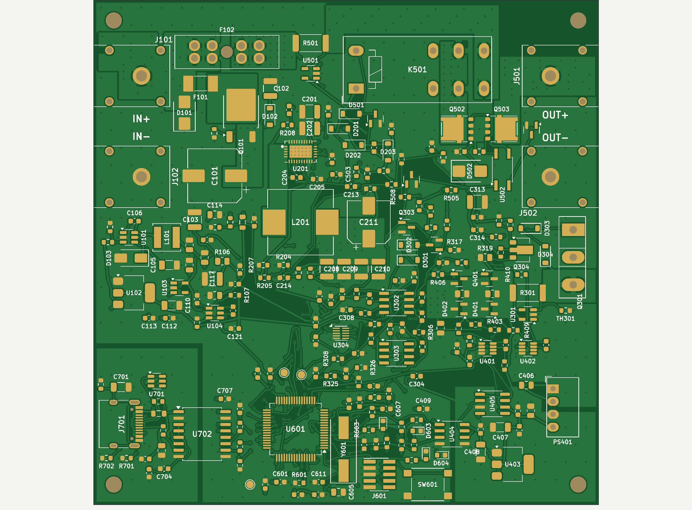
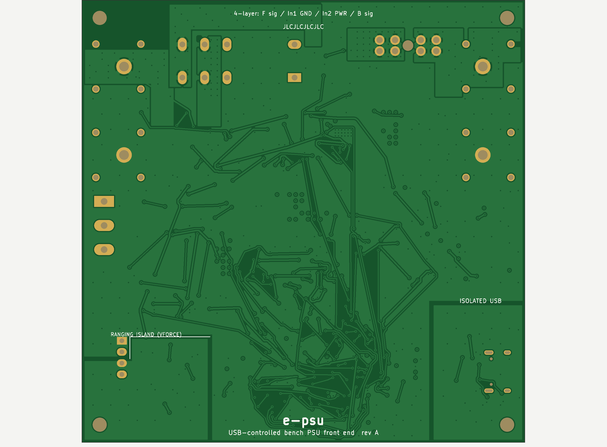

# e-psu hardware

An open-source front end that adds USB control to a 0–30 V / 10 A bench power supply. It measures current with auto-ranging, is built around an STM32G474, and has a 4-layer KiCad board ready for JLCPCB assembly.

| Top | Bottom |
|---|---|
|  |  |

> **Status: rev A, not built yet.** The schematic is complete and simulated, and the board is fully routed (KiCad DRC: 0 errors, 0 unconnected). See [Before ordering](#before-ordering).

## What it does

- Sits between a 30 V bench supply and the load. Sets output voltage (0–30 V) and current limit over USB.
- **Precision path, up to 3 A:**
  - tracking buck pre-regulator (LM76003);
  - IRFP260N linear stage with CV/CC loops (OPA2192) and DAC80502 setpoints;
  - hardware overcurrent clamp.
- **Current measurement:** three ranges (3 A, 30 mA and 300 µA), using 15 mΩ, 1 Ω and 100 Ω shunts with INA293/INA190 amplifiers. Range switching is hardware-triggered, with bypass FETs on an isolated gate-drive island.
- **10 A pass-through:** 2 mΩ shunt with INA281, selected by a relay.
- **Output:** back-to-back FET output switch and voltage sense at the output terminal.
- **USB-C,** isolated with an ADuM3160.

## Repository layout

| Folder | Contents |
|---|---|
| [`kicad/`](kicad/) | KiCad 7 project: 8-page schematic (rev A1), the PCB, project symbols and footprints, schematic PDF |
| [`pcb/`](pcb/) | Python scripts that generate, place and route the board, and produce the fab outputs |
| [`fab/`](fab/) | JLCPCB Gerbers and drill files, BOM, CPL, renders |
| [`sim/`](sim/) | ngspice simulation of the analog stage, reading component values from the schematic ([report](sim/REPORT.md)) |
| [`gen/`](gen/) | Python schematic generator. It is one-way and overwrites `kicad/`. |
| [`PROJECT_CONTEXT.md`](PROJECT_CONTEXT.md) | Design summary, decisions and open items |

## Board

- 100 × 100 mm, 4 layers, 1.6 mm FR-4: F.Cu signals / In1 GND / In2 power / B.Cu signals.
- The 10 A path runs as pours on three layers.
- Kelvin-connected shunts.
- Split ground for the isolated USB side and the ranging island.
- The TO-247 pass FET sits at the board edge, ready for a heatsink.

Details are in [`pcb/README.md`](pcb/README.md).

## Before ordering

1. **Replace the U201 footprint.** The LM76003 footprint (TI RNP0030B, WQFN-30) is provisional. After replacing it, re-route the buck corner.
2. **Check pinouts against the datasheets:** HF115F relay, B0505S, VOM1271.
3. **Run ERC in KiCad.**
4. **JLCPCB order options:** 1 oz inner copper. Also check part rotations in the CPL preview.
5. **Add LCSC part numbers** for the passives that don't have one yet.

## License

[CERN-OHL-P-2.0](LICENSE)
