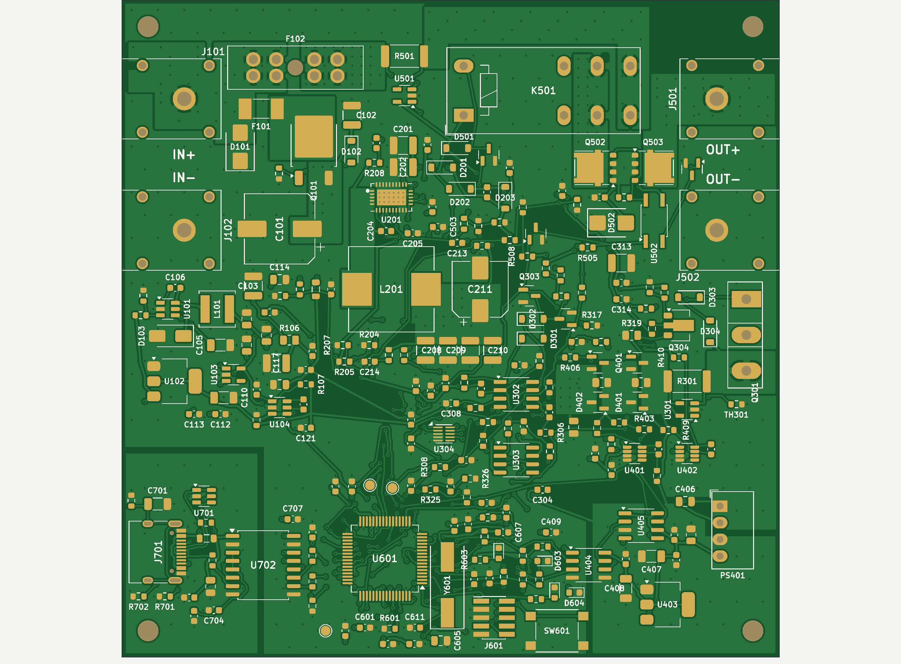

# e-psu rev A: PCB

A 100 × 100 mm, 4-layer board, built from the schematic by scripts and routed automatically. The KiCad files are in `../kicad/` and the manufacturing files are in `../fab/`.



## Status

| | |
|---|---|
| Routing | Complete: 244 footprints, 155 nets, 5,275 track segments (3.7 m), 887 vias |
| KiCad DRC | **0 errors, 0 unconnected.** 39 silkscreen warnings: 30 overlaps, 8 at the board edge where the banana jacks overhang, and 1 over copper. |
| Isolation | No track crosses the GND / GND_USB split. U702 (ADuM3160), U404 and PS401 straddle their gaps. |
| Not final | U201 footprint is provisional, so the buck corner must be re-routed once the real footprint is in. |

## Board

| | |
|---|---|
| Size | 100 × 100 mm, 4 × M3 holes, 1.6 mm FR-4 |
| Stack | F.Cu signals and pours / In1 GND plane / In2 power planes / B.Cu signals and pours |
| Copper | 1 oz outer. **Specify 1 oz inner** (JLCPCB option) for the 10 A path on In2. |
| Rules | 0.2 mm track / 0.15 mm clearance (signals); vias 0.6 / 0.3 mm; JLCPCB standard 4-layer process |
| Parts | All SMD and THT parts on the top side |

### Copper plan

- **10 A pass-through** (J101 → F102 → R501 → K501 → Q502/Q503 → J501). It runs as pours on F.Cu, In2 and B.Cu along the top edge, stitched with 0.6 mm via arrays.
- **3 A precision path:**
  - F101 → Q101 → VIN_PROT;
  - buck → VPRE corridor on In2 → Q301;
  - R301 → ranging chain;
  - VSENSE corridor on In2 → K501 NC.
  
  These are local pours with via arrays.
- **Ranging chain.** The parts sit between three copper bars: VFORCE → N_MID → VSENSE.
  - R401/Q401/D401 bridge VFORCE to N_MID.
  - R402/Q402/D402 bridge N_MID to VSENSE.
- **Kelvin sense traces.** R501 → U501 and R301 → U301 are fixed traces that leave the inner edges of the shunt pads.
- **In1** is a GND plane. It is split into:
  - GND_USB under the PC side of the ADuM3160;
  - VFORCE under the isolated ranging driver (PS401, U403, U405, U404 side 2).
  
  Both islands have 1 mm gaps. The splits are also drawn on the bottom silkscreen.
- **Outer GND fills.** F.Cu and B.Cu are flooded with the matching ground of each region, stitched to In1 on a 4 mm grid.

## How the board is built

```bash
python3 make_board.py --own     # full build as used for rev A: placement, copper, grid router, fills, DRC (~1 h)
python3 make_board.py --tidy    # rip and re-route whatever the last DRC flagged, then DRC again
python3 make_board.py           # same build, with Freerouting for the first pass (it leaves ~60 open on this board)
python3 fab.py                  # Gerbers, drill, BOM, CPL into ../fab
python3 render.py ../fab/renders   # top/bottom PNG renders
```

KiCad overwrites the project's net-class patterns whenever a board is saved from Python, so the scripts re-write them with `copper.write_project()` after every save. Run DRC from KiCad or `drc.py` in a fresh process.

| Script | Step |
|---|---|
| `build_pcb.py`, `place.py` | Footprints from the netlist. Hand-placed anchors for the power path and connectors, then a connectivity-driven placer inside block regions. |
| `power.py`, `copper.py` | Net classes and rules, pours and planes, Kelvin traces, stitching vias |
| `fanout.py` | A trace and via from every SMD pad of a plane net into its plane |
| `route.py` | DSN export (net classes plus keepouts that protect the pours), Freerouting in batch mode, SES import |
| `finisher.py` | Grid maze router with rip-up. It completes the connections Freerouting leaves open, using KiCad's own DRC report as the to-do list. |
| `finish.py`, `silk.py` | Removes dangling stubs, adds outer ground fills and stitching, cleans up reference designators, adds markings |
| `drc.py` | KiCad DRC and report summary |
| `fab.py` | JLCPCB outputs |
| `render.py` | Top/bottom renders from the Gerber-equivalent layers |

Requirements:
- KiCad 7 (pcbnew Python module and kicad-cli);
- Java 21 with Freerouting 2.1, only for the Freerouting mode. Download the jar to `../tools/freerouting.jar`; it is not in the repo.
- Python packages: shapely, numpy, scipy, matplotlib, cairosvg, pillow.

## Ordering at JLCPCB

1. Upload `../fab/e-psu-revA-gerbers.zip`: 4 layers, 1.6 mm, **inner copper 1 oz** (not 0.5 oz), any colour, "Specify a location" for the order number (the `JLCJLCJLCJLC` text on the bottom).
2. For assembly, upload `e-psu-revA-bom.csv` and `e-psu-revA-cpl.csv`.
   - 69 of the 100 BOM lines (mostly passives) have no LCSC number yet. Pick them in JLC's matcher or add them to the schematic's LCSC field.
   - Check every part's rotation in JLC's placement preview, especially the SOT-23, SO-8FL and QFN parts.
3. THT parts: J101/J102/J501/J502 (banana jacks), F102, K501, Q301 and PS401. Hand-solder them or order THT assembly. J701 (USB-C) has THT shell tabs, and JLC places it.
