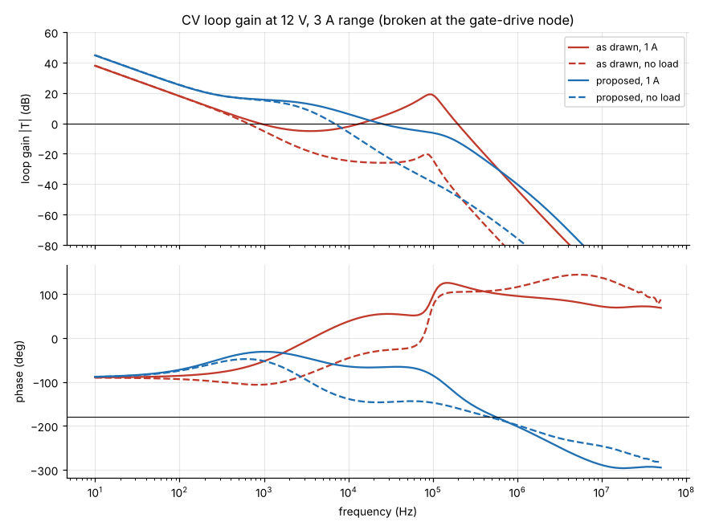
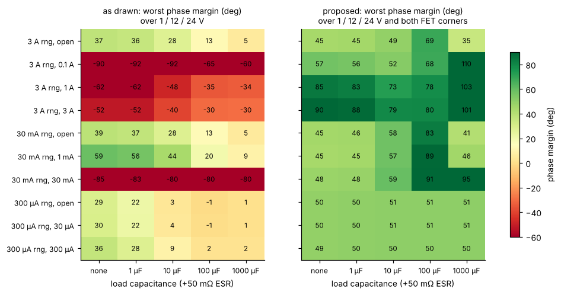
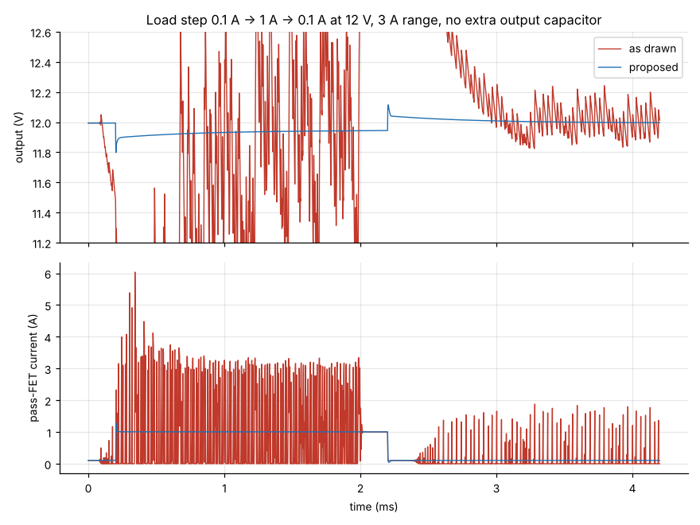
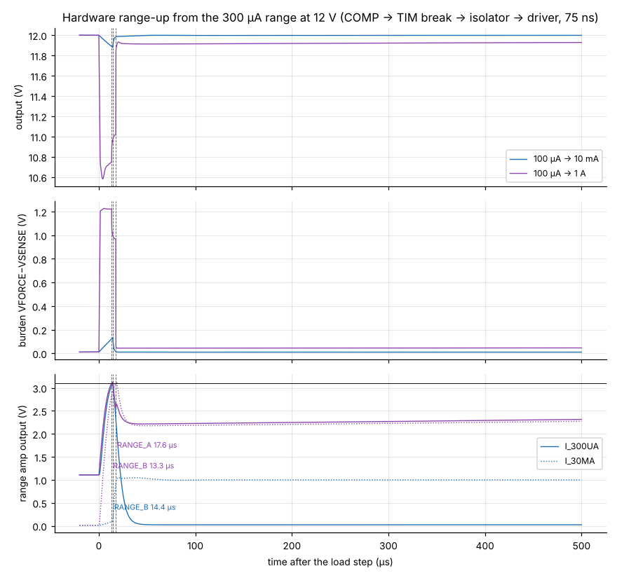
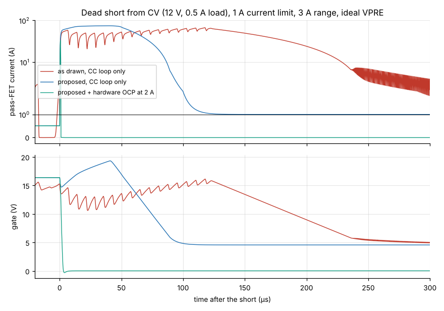
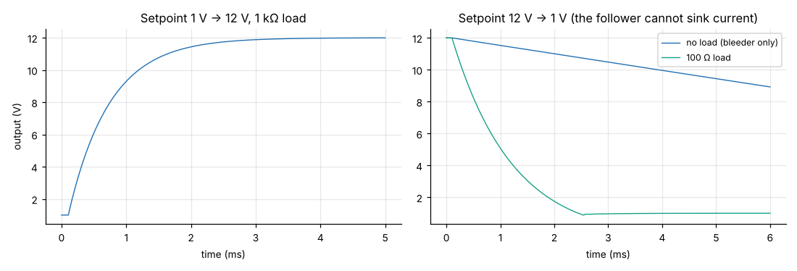
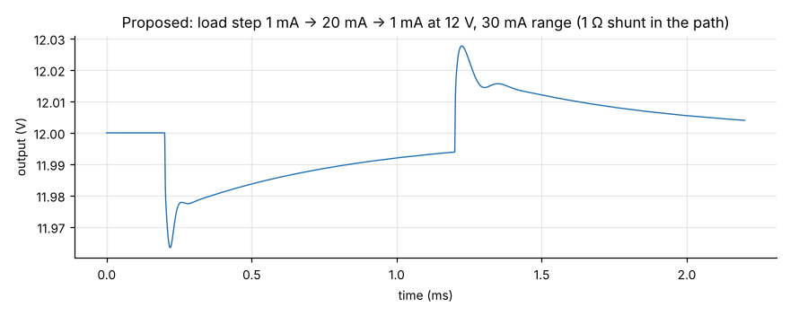
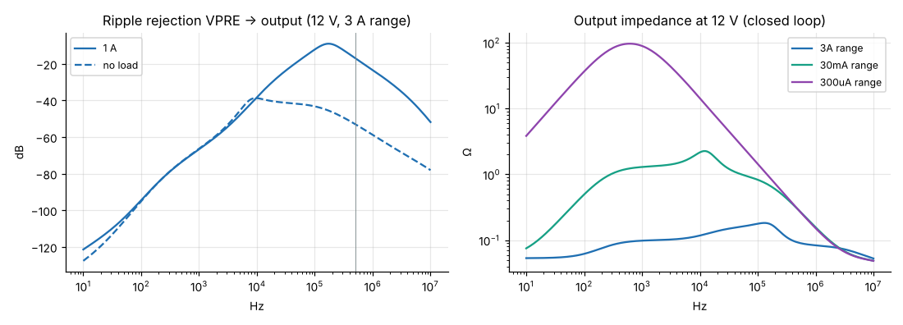
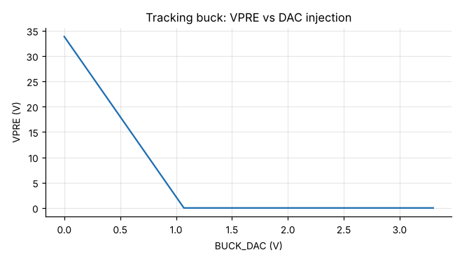

# e-psu rev A: analog simulation report

These are ngspice simulations of the linear CV/CC stage, the current ranging and the output path. All R, C and L values are read from the KiCad schematic, so the results stay in sync with it. Every number below comes from `results/` and can be reproduced with `python3 sweep.py && python3 make_plots.py`.

## Summary

1. **As drawn, the CV loop is unstable over most of the operating range.** Out of 150 load cases, phase margin goes as low as −92°, and 52 cases are below 0°. In the time domain this shows up as a sustained oscillation: at 12 V / 1 A the output swings between 11.4 V and 12.6 V (plot below). The CC loop is marginal: worst case −15°, median 13°.
2. **Changing nine values and adding one resistor fixes this** (see the table below):
   - **CV loop:** worst case **35°** over 300 cases (both FET corners). The median is 63°, and the worst case with the typical-FET model is 45°.
   - **CC loop:** worst case **91°**.
   - **Crossover:** 24 kHz at 1 A and 4–7 kHz with no load.
3. **A dead short from CV needs the hardware OCP.** The analog CC loop alone takes about 95 µs to take over, because its integrator sits wound up at the 30 V rail in CV mode. During that time the pass FET carries tens of amps (74 A peak with an ideal VPRE). With COMP3 → TIM20 break → Q303 modelled, the current is above 3 A for only 0.9 µs (33 A peak).
4. **Hardware range-up takes 13–18 µs, not ~1 µs.** The INA190 output slews at only 0.3 V/µs.
   - 100 µA → 10 mA: the output dips 120 mV.
   - 100 µA → 1 A: the output dips 1.4 V while the BAV199 clamps hold the burden voltage at 1.2 V.
5. **Ripple from the tracking buck passes through at heavy load.** VPRE-to-output rejection at 500 kHz is only about 17 dB at 1 A, and 53 dB with no load.
6. **The analog CC loop can't limit below about 30 mA.** The INA293 output floor (about 5 mV, which is 6.7 mA) and the bleeder current, which flows through the CC shunt, set that limit. Lower limits need firmware working from the range amplifiers.
7. **Down-programming with no load is slow.** The source follower cannot sink current, so with no load only the bleeder discharges the output: 12 V → 1 V takes about 20 ms, or seconds with a large external capacitor. With a 100 Ω load it takes 1.7 ms.
8. **The tracking buck injection works as designed:** VPRE = 33.8 V − 31.6 × BUCK_DAC. BUCK_DAC = 0.2 V gives 27.5 V and 1.0 V gives 1.9 V, about 25 mV per DAC step. **BUCK_DAC = 0 V commands VPRE above VIN**, so the buck runs at maximum duty. Firmware must clamp BUCK_DAC to at least 0.2 V. In reset the G474 DAC output is high-impedance, which gives 2 V and is safe.

## Proposed changes (linear sheet)

| Ref | Rev A | Proposed | Why |
|---|---|---|---|
| C304 | 1 nF | **5.6 nF C0G** | Feed-forward path from the force node |
| R327 (new) | — | **8.2 kΩ**, in series with C304 | Makes the feed-forward path resistive at high frequency. Without it, R305 and C304 form a differentiator. |
| C305 | 9.1 nF | **not fitted** | 10 nF on the inverting input made the op-amp's own feedback loop ring at about 120 kHz. With the CV integrator, FBV is a virtual ground, so the C304/C305 divider ratio has no effect. |
| R305 | 10 kΩ | **3.9 kΩ** | High-frequency gain about 0.5 |
| C306 | 2.2 nF | **1 nF C0G** | Integrator corner at about 290 Hz. Mid-band gain about 6. |
| R307 | 10 kΩ | **1 kΩ** | CC high-frequency gain 1 → 0.1. The 10 µF on the force node turns the CC sense path into a differentiator, so its gain reaches 0.75 × gm ≈ 15. |
| C307 | 4.7 nF | **1.5 nF** | CC loop 3–4× faster with at least 91° margin |
| R319 | 330 Ω | **68 Ω** | Bleeder 2 mA → 10 mA. This raises the follower's transconductance with no load, which sets the margin with large capacitors: the worst case is 18° at 2 mA, 42° at 5 mA and 50° at 10 mA. |
| R318 | 1 kΩ | **100 Ω** | Keeps the bleeder working down to about 1 V output. With 1 kΩ it starves below about 3 V. |
| Q304 | MMBT3904 | **SOT-89 NPN (e.g. BCX56-16)** | About 0.25 W at 24 V and 10 mA |

The tuning trade-off: a stronger integrator settles faster, but loses margin at no load with 1000 µF on the output, where the follower's output pole drops to tens of Hz. A 0.1 → 1 A step dips 196 mV (the FET's VGS change). It is back within 34 mV after 200 µs and within 8 mV after 1 ms. The `tune.py` and `corners.py` scripts let you move this point.

## Stability

The loop gain is measured with Tian's method at the gate-drive node, between the diode-OR node and R313, so it covers whichever of CV or CC is in control. Each case first finds its operating point with a damped copy of the circuit that has the same DC solution. That way an unstable loop cannot hide the operating point. The method was checked against an analytic loop and matches exactly.

The case matrix:
- **Voltages:** 1, 12 and 24 V.
- **Loads:** open, 0.1, 1 and 3 A in the 3 A range; open, 1 and 30 mA in the 30 mA range; open, 30 and 300 µA in the 300 µA range.
- **Load capacitance:** none, 1, 10, 100 and 1000 µF, each with 50 mΩ ESR.
- **FET models:** two IRFP260N corners.

For CC, limits of 30 mA, 0.1 A, 1 A and 3 A were run into a short and into a half-voltage resistor, with 0, 10 µF and 1000 µF. The full tables are in `results/cv_*.csv` and `results/cc_*.csv`.

## Transients

| Test | Result (proposed) |
|---|---|
| 0.1 → 1 A at 12 V, 3 A range | min 11.798 V (−197 mV); −34 mV at 200 µs, −8 mV at 1 ms; on release it peaks at 12.115 V (+120 mV) and settles slowly, because the follower cannot sink current |
| 1 → 20 mA, 30 mA range | −37 mV / +28 mV |
| Range-up 100 µA → 10 mA | RANGE_B after 14.4 µs; dip to 11.88 V |
| Range-up 100 µA → 1 A | RANGE_B 13.3 µs, RANGE_A 17.6 µs; dip to 10.58 V; burden voltage 1.23 V max |
| Short from CV, 1 A limit, CC loop only | 74 A peak; above 3 A for 95 µs (as drawn: 300 µs, then oscillates) |
| Same with hardware OCP at 2 A (75 ns chain) | 33 A peak; above 3 A for 0.9 µs; output latched off |
| Setpoint 1 → 12 V, 1 kΩ load | 90 % after 1.5 ms, no overshoot |
| Setpoint 12 → 1 V | no load: about 20 ms; 100 Ω load: 1.7 ms |

## Ripple rejection, output impedance and buck injection

**Ripple rejection from VPRE at 1 A:** −94 dB at 100 Hz, −38 dB at 10 kHz, −12 dB at 100 kHz, −17 dB at 500 kHz.

**Output impedance at 12 V (closed loop):**
- 3 A range: 54 mΩ at DC (relay plus switch after the sense point), rising to 0.18 Ω at 100 kHz.
- 300 µA range: up to about 90 Ω around 1 kHz, from the 101 Ω shunt, which the loop corrects only slowly.

## Suggestions beyond the value changes

- **OCP:** keep COMP3/COMP4/COMP6 → TIM20 OCP armed whenever the output is on. Set its threshold close to the CC limit, for example ILIM + 50 % or ILIM + 0.5 A. The AO3400A bypass FETs are rated about 30 A pulsed. A real VPRE (87 µF and the buck's current limit) will soften the spike, so measure it on the first board.
- **Faster range-up:** the dip comes from the INA190 slew rate and C401 (1 µF).
  - A bigger C401 (4.7–10 µF) cuts the dip proportionally. It costs a slower step response in the 300 µA range.
  - A faster trip path, such as a comparator on the burden voltage, would cut the delay itself.
- **VPRE ripple:** a small LC filter on VPRE (about 1 µH plus 22 µF), or more headroom above about 1 A, if output ripple matters at full load.
- **Low current limits:** for limits below about 50 mA, add the bleeder current to the CC setpoint and enforce the limit in firmware from I_30MA / I_300UA, or add a range-aware analog CC path in rev B.
- **Active discharge:** optional, for fast down-programming, for example a FET plus resistor switched by firmware.

## Models and limits

- **OPA192 / OPA2192:** macromodel with 10 MHz GBW, 20 V/µs, 134 dB Aol, 375 Ω open-loop output impedance, a second pole for about 60° margin at unity gain, and integrator clamps near the rails. This is not TI's model.
- **INA293A2:** 1.3 MHz, 2.5 V/µs.
- **INA190A3:** 35 kHz, 0.3 V/µs. Its 80 µs overload recovery is **not** modelled.
- **IRFP260N:** VDMOS in two corners. The "typical" corner is fitted to Infineon's SPICE model; the "weak" corner has transconductance at the datasheet minimum and a pessimistic subthreshold slope.
- **AO3400A:** from its datasheet (19 mΩ, 630 pF, Rg 3 Ω).
- **BAV199:** Nexperia SPICE parameters.
- **Not modelled:**
  - the relay and output switch are plain resistors (50 mΩ, 2 × 1.8 mΩ);
  - VPRE and the setpoint DAC are ideal sources;
  - temperature, noise and PCB parasitics.
- **Range-up chain:** COMP 17 ns, break-to-pin about 30 ns (estimate), CA-IS3720 12 ns and UCC27524A 13 ns, 75 ns in total.

Swap in vendor models in `models/` to tighten the numbers. Loop shapes and conclusions should hold, because the instability mechanisms are structural (op-amp noise gain, differentiating feedback, follower output pole).
